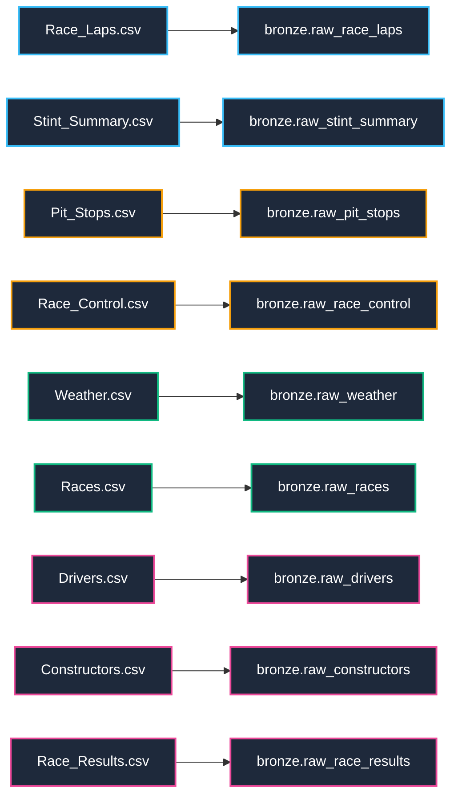

# Bronze Layer: Raw Datasets Reference & Data Dictionary

Database: `f1_warehouse`  
Layer: `bronze`  
Design Paradigm: Lossless Text Ingestion Staging (ELT Pattern)  
Championship Coverage: 2023, 2024, 2025 Formula 1 Seasons  
Source Directory: `raw_data/`  
Total Raw Datasets: 9 CSV files  
Total Ingested Records: 125,984 rows  

---

## 1. Executive Summary & Architecture Overview

The Bronze layer serves as the initial staging foundation of the Medallion Data Warehouse Architecture for the Formula 1 Race Strategy Recommendation system. 

```
+--------------------------------------------------------------------------+
|                       SOURCE CSVs (raw_data/)                           |
|  Race_Laps | Stint_Summary | Pit_Stops | Race_Control | Weather          |
|  Races | Drivers | Constructors | Race_Results                           |
+--------------------------------------------------------------------------+
                                     |
                                     v [psql \copy - Pure SQL]
+--------------------------------------------------------------------------+
|                    BRONZE LAYER (Schema: bronze)                         |
|  All source columns staged as TEXT / VARCHAR to prevent truncation       |
|  Lineage metadata columns: _ingested_at (TIMESTAMP), _source_file (TEXT)  |
|  Diagnostics: bronze.vw_ingestion_audit_summary                          |
+--------------------------------------------------------------------------+
                                     |
                                     v [Phase 2: Cleaning & Typing]
+--------------------------------------------------------------------------+
|                     SILVER STAR SCHEMA (Schema: silver)                  |
|  Dimensions: dim_races, dim_drivers, dim_constructors                   |
|  Facts: fact_race_laps, fact_pit_stops, fact_weather,                   |
|         fact_race_control, fact_stint_summary, fact_race_results         |
+--------------------------------------------------------------------------+
```

### Architectural Principles:
1. **Pure SQL Staging**: Ingestion is handled strictly via PostgreSQL DDL and `\copy` statements without external transformation runtimes (Python/Pandas).
2. **Lossless Type Preservation**: Every source attribute is staged as `TEXT` so that raw strings, edge-case null formats, and sensor anomalies are preserved exactly as delivered.
3. **Auditability & Lineage Tracking**: Every bronze table is automatically appended with `_ingested_at` (defaulting to `CURRENT_TIMESTAMP`) and `_source_file` (name of the originating CSV).
4. **Diagnostic Verification**: Automated diagnostic queries profile row counts, season distributions, null frequencies, and natural-key uniqueness prior to silver-layer transformation.

---

## 2. Team Task Allocation & Ingestion Audit Summary

Responsibilities for the Bronze layer are allocated across the four engineering team members:

| Team Member | Staged Tables | Source CSV Files | Tasks |
| :--- | :--- | :--- | :--- |
| **Mohamed** | `bronze.raw_race_laps`<br>`bronze.raw_stint_summary` | `Race_Laps.csv`<br>`Stint_Summary.csv` | Tasks 1.1, 1.2, 1.3 |
| **Yousef** | `bronze.raw_pit_stops`<br>`bronze.raw_race_control` | `Pit_Stops.csv`<br>`Race_Control.csv` | Tasks 1.4, 1.5 |
| **Mahmud** | `bronze.raw_weather`<br>`bronze.raw_races` | `Weather.csv`<br>`Races.csv` | Tasks 1.6, 1.7 |
| **Moaz** | `bronze.raw_drivers`<br>`bronze.raw_constructors`<br>`bronze.raw_race_results` | `Drivers.csv`<br>`Constructors.csv`<br>`Race_Results.csv` | Tasks 1.8, 1.9, 1.10 |

### Master Ingestion Audit Summary (`bronze.vw_ingestion_audit_summary`)

The table below reflects the exact output generated by the bronze ingestion audit query:

| Team Member | Bronze Table Name | Source Rows | Source Columns | NULL Cells | Duplicate Key Groups | Extra Rows |
| :--- | :--- | ---: | ---: | ---: | ---: | ---: |
| **Mohamed** | `raw_race_laps` | 77,373 | 54 | 269,415 | 0 | 0 |
| **Mohamed** | `raw_stint_summary` | 3,934 | 24 | 6,143 | 0 | 0 |
| **Yousef** | `raw_pit_stops` | 2,339 | 16 | 1,488 | 0 | 0 |
| **Yousef** | `raw_race_control` | 6,286 | 17 | 22,585 | 8 | 8 |
| **Mahmud** | `raw_weather` | 34,420 | 16 | 0 | 28 | 28 |
| **Mahmud** | `raw_races` | 70 | 22 | 210 | 0 | 0 |
| **Moaz** | `raw_drivers` | 106 | 12 | 2 | 34 | 38 |
| **Moaz** | `raw_constructors` | 30 | 7 | 0 | 0 | 0 |
| **Moaz** | `raw_race_results` | 1,397 | 20 | 811 | 0 | 0 |
| **TOTAL** | **9 Tables** | **125,984** | **188** | **300,654** | **70** | **74** |

---

## 3. Comprehensive Raw Dataset Dictionaries



---

### Dataset 1: `Race_Laps.csv` -> `bronze.raw_race_laps`

- **Owner**: Mohamed
- **SQL Script**: `sql/01_bronze/01_mohamed_bronze_laps_stints.sql`
- **Source File**: `raw_data/Race_Laps.csv` (~28.7 MB)
- **Granularity**: 1 record per driver per race lap
- **Total Records**: 77,373 rows (2023: 24,479 | 2024: 26,629 | 2025: 26,265)
- **Natural Key**: `(session_key, driver_number, lap_number)` (0 duplicate key groups)
- **Downstream Silver Target**: `silver.fact_race_laps`

#### Business & Engineering Purpose
`Race_Laps.csv` is the core high-frequency telemetry dataset of the warehouse. It captures individual lap times, micro-sector split times (S1, S2, S3), speed-trap velocities, tyre life progression, track flag conditions, and localized lap weather. It provides the empirical data required to calculate tyre degradation decay, evaluate driver pace relative to the 107% outlier threshold, compute fuel-corrected lap times, and drive the Phase 3 Race State Timeline replay.

#### Column Catalog & Data Types

| Column Name | Staged Type | Silver Target Type | Description & Race Strategy Meaning | Sample Value |
| :--- | :--- | :--- | :--- | :--- |
| `year` | TEXT | INTEGER | Championship season year | `2023` |
| `round` | TEXT | INTEGER | Calendar round number | `1` |
| `meeting_key` | TEXT | INTEGER | FIA meeting key | `1141` |
| `meeting_name` | TEXT | VARCHAR(100) | Grand Prix meeting title | `Bahrain Grand Prix` |
| `session_key` | TEXT | INTEGER | Unique race session identifier | `7953` |
| `session_name` | TEXT | VARCHAR(50) | Session type (strictly `Race`) | `Race` |
| `circuit_short_name`| TEXT | VARCHAR(50) | Circuit identifier name | `Sakhir` |
| `country_name` | TEXT | VARCHAR(50) | Grand Prix host country | `Bahrain` |
| `date_start` | TEXT | TIMESTAMP | UTC start timestamp of lap | `2023-03-05 15:03:38.500` |
| `driver_number` | TEXT | INTEGER | Permanent FIA racing number | `1` |
| `lap_number` | TEXT | INTEGER | Consecutive lap number in race | `1` |
| `lap_duration` | TEXT | DOUBLE PRECISION | Total lap duration in seconds | `99.359` |
| `duration_sector_1` | TEXT | DOUBLE PRECISION | Sector 1 split duration (seconds) | `33.103` |
| `duration_sector_2` | TEXT | DOUBLE PRECISION | Sector 2 split duration (seconds) | `42.414` |
| `duration_sector_3` | TEXT | DOUBLE PRECISION | Sector 3 split duration (seconds) | `23.842` |
| `i1_speed` | TEXT | DOUBLE PRECISION | Intermediate 1 speed trap (km/h) | `232.0` |
| `i2_speed` | TEXT | DOUBLE PRECISION | Intermediate 2 speed trap (km/h) | `231.0` |
| `st_speed` | TEXT | DOUBLE PRECISION | Longest straight speed trap (km/h) | `252.0` |
| `is_pit_out_lap` | TEXT | BOOLEAN | True if lap immediately follows pit exit | `False` |
| `date_end` | TEXT | TIMESTAMP | UTC completion timestamp of lap | `2023-03-05 15:05:17.859` |
| `name_acronym` | TEXT | VARCHAR(3) | Three-letter driver acronym | `VER` |
| `full_name` | TEXT | VARCHAR(100) | Full driver name | `Max VERSTAPPEN` |
| `team_name` | TEXT | VARCHAR(100) | Constructor team name | `Red Bull Racing` |
| `stint_number` | TEXT | INTEGER | Sequential stint index for driver | `1` |
| `compound` | TEXT | VARCHAR(20) | Tyre compound (SOFT, MEDIUM, HARD, etc.) | `SOFT` |
| `tyre_age_at_start` | TEXT | DOUBLE PRECISION | Pre-existing tyre age at start of stint | `3.0` |
| `stint_lap_start` | TEXT | INTEGER | Lap number stint commenced | `1` |
| `stint_lap_end` | TEXT | INTEGER | Lap number stint terminated | `14` |
| `compound_code` | TEXT | VARCHAR(10) | Pirelli compound code (C1-C6; raw NULL) | `NULL` |
| `tyre_age_laps` | TEXT | DOUBLE PRECISION | Total laps run on tyre set at lap end | `3.0` |
| `tyre_is_new` | TEXT | BOOLEAN | True if tyre set was brand new | `False` |
| `pit_lane_duration_s`| TEXT | DOUBLE PRECISION | Elapsed time in pit lane during lap | `NULL` |
| `pit_stop_duration_s`| TEXT | DOUBLE PRECISION | Stationary service time in box | `NULL` |
| `is_pit_in_lap` | TEXT | BOOLEAN | True if lap finishes by entering pit lane| `False` |
| `safety_car_in_lap` | TEXT | BOOLEAN | True if Safety Car was active during lap | `False` |
| `vsc_in_lap` | TEXT | BOOLEAN | True if Virtual Safety Car was active | `False` |
| `red_flag_in_lap` | TEXT | BOOLEAN | True if session was red-flagged | `False` |
| `yellow_events_in_lap`| TEXT | INTEGER | Count of yellow incidents logged on lap | `2` |
| `yellow_flag_in_lap`| TEXT | BOOLEAN | True if yellow flag waved during lap | `True` |
| `race_condition` | TEXT | VARCHAR(20) | Dominant race status (GREEN, YELLOW) | `YELLOW` |
| `weather_air_temperature` | TEXT | DOUBLE PRECISION | Ambient air temperature (Celsius) | `27.3` |
| `weather_track_temperature`| TEXT | DOUBLE PRECISION | Track surface temperature (Celsius) | `31.2` |
| `weather_humidity` | TEXT | DOUBLE PRECISION | Relative humidity percentage | `22.0` |
| `weather_pressure` | TEXT | DOUBLE PRECISION | Atmospheric pressure (mbar) | `1016.7` |
| `weather_wind_speed`| TEXT | DOUBLE PRECISION | Wind speed velocity (m/s) | `0.5` |
| `weather_wind_direction` | TEXT | INTEGER | Wind heading angle (0-360 degrees) | `226` |
| `weather_rainfall` | TEXT | DOUBLE PRECISION | Precipitation sensor state (0.0 = Dry) | `0.0` |
| `rainfall_share_of_lap` | TEXT | DOUBLE PRECISION | Percentage of lap afflicted by rain | `0.0` |
| `position_end_of_lap`| TEXT | INTEGER | Running race position across finish line | `1` |
| `lap_is_clean` | TEXT | BOOLEAN | True if unhampered by traffic or flags | `False` |
| `fuel_corrected_lap_time` | TEXT | DOUBLE PRECISION | Lap time normalized for fuel burn-off | `99.359` |
| `deg_vs_stint_best_s`| TEXT | DOUBLE PRECISION | Delta time vs stint best lap (seconds) | `NULL` |
| `stint_deg_slope_s_per_lap`| TEXT | DOUBLE PRECISION | Stint degradation gradient (seconds/lap) | `0.17908` |
| `is_first_lap` | TEXT | BOOLEAN | True if standing start opening lap | `True` |
| `_ingested_at` | TIMESTAMP | TIMESTAMP | Warehouse audit ingestion timestamp | Current Timestamp |
| `_source_file` | TEXT | VARCHAR(50) | Ingested source file name | `Race_Laps.csv` |

#### Quality Quirks & Silver Transformation Plan
- `lap_duration`: 258 NULL entries correspond to opening laps of retired cars or timing beacon signal loss.
- Missing speed trap values (`i1_speed`: 12,294 nulls, `i2_speed`: 1,119 nulls, `st_speed`: 6,606 nulls) occur when intermediate loops fail. Imputed in Silver using rolling driver-session median.
- `compound_code`: 73,084 NULLs are enriched via a relational join to `silver.dim_races` on compound allocation (`C_hard`, `C_medium`, `C_soft`).

---

### Dataset 2: `Stint_Summary.csv` -> `bronze.raw_stint_summary`

- **Owner**: Mohamed
- **SQL Script**: `sql/01_bronze/01_mohamed_bronze_laps_stints.sql`
- **Source File**: `raw_data/Stint_Summary.csv` (~650 KB)
- **Granularity**: 1 record per driver per tyre stint per race session
- **Total Records**: 3,934 rows
- **Natural Key**: `(session_key, driver_number, stint_number)` (0 duplicates)
- **Downstream Silver Target**: `silver.fact_stint_summary`

#### Business & Engineering Purpose
Aggregates driver performance across complete tyre runs. It establishes stint boundaries, tyre compounds utilized, scrubbed vs new tyre state, average clean-lap pace, and calculated tyre degradation rates (both unadjusted and fuel-corrected). These metrics serve as direct feature inputs for machine learning pace and degradation models in Phase 4.

#### Column Catalog & Data Types

| Column Name | Staged Type | Silver Target Type | Description & Race Strategy Meaning | Sample Value |
| :--- | :--- | :--- | :--- | :--- |
| `year` | TEXT | INTEGER | Championship season year | `2023` |
| `round` | TEXT | INTEGER | Calendar round number | `1` |
| `meeting_key` | TEXT | INTEGER | FIA meeting identifier | `1141` |
| `meeting_name` | TEXT | VARCHAR(100) | Grand Prix meeting title | `Bahrain Grand Prix` |
| `session_key` | TEXT | INTEGER | Race session key | `7953` |
| `session_name` | TEXT | VARCHAR(50) | Session type (`Race`) | `Race` |
| `circuit_short_name`| TEXT | VARCHAR(50) | Circuit identifier name | `Sakhir` |
| `country_name` | TEXT | VARCHAR(50) | Host country name | `Bahrain` |
| `driver_number` | TEXT | INTEGER | Permanent driver number | `1` |
| `name_acronym` | TEXT | VARCHAR(3) | Three-letter driver acronym | `VER` |
| `team_name` | TEXT | VARCHAR(100) | Constructor team name | `Red Bull Racing` |
| `stint_number` | TEXT | INTEGER | Stint sequence index (1, 2, 3...) | `1` |
| `compound` | TEXT | VARCHAR(20) | Nominal compound (SOFT, MEDIUM, HARD) | `SOFT` |
| `compound_code` | TEXT | VARCHAR(10) | Pirelli compound code (C1-C6; raw NULL) | `NULL` |
| `lap_start` | TEXT | INTEGER | Race lap on which stint began | `1` |
| `lap_end` | TEXT | INTEGER | Race lap on which stint concluded | `14` |
| `laps` | TEXT | INTEGER | Total duration of stint in laps | `14` |
| `tyre_age_at_start` | TEXT | DOUBLE PRECISION | Prior tyre age in laps | `3.0` |
| `tyre_is_new` | TEXT | BOOLEAN | True if tyre set was fresh/unscrubbed | `False` |
| `clean_laps` | TEXT | INTEGER | Count of green-flag, traffic-free laps | `13` |
| `avg_clean_lap_s` | TEXT | DOUBLE PRECISION | Mean lap duration over clean laps (s) | `98.435` |
| `best_lap_s` | TEXT | DOUBLE PRECISION | Fastest clean lap time in stint (s) | `97.974` |
| `deg_slope_raw_s_per_lap` | TEXT | DOUBLE PRECISION | Uncorrected degradation slope (s/lap) | `0.14908` |
| `deg_slope_fuel_corrected_s_per_lap` | TEXT | DOUBLE PRECISION | True physical rubber degradation (s/lap) | `0.17908` |
| `_ingested_at` | TIMESTAMP | TIMESTAMP | Ingestion audit timestamp | Current Timestamp |
| `_source_file` | TEXT | VARCHAR(50) | Originating source file | `Stint_Summary.csv` |

#### Quality Quirks & Silver Transformation Plan
- `deg_slope_raw_s_per_lap` and fuel-corrected slopes are NULL on stints with fewer than 3 clean laps (e.g. early DNFs or prolonged Safety Car interventions). Handled in Silver via imputation from teammate or compound averages.

---

### Dataset 3: `Pit_Stops.csv` -> `bronze.raw_pit_stops`

- **Owner**: Yousef
- **SQL Script**: `sql/01_bronze/02_yousef_bronze_pits_control.sql`
- **Source File**: `raw_data/Pit_Stops.csv` (~283 KB)
- **Granularity**: 1 record per pit stop event per driver per lap
- **Total Records**: 2,339 rows
- **Natural Key**: `(session_key, driver_number, lap_number)` (0 duplicates)
- **Downstream Silver Target**: `silver.fact_pit_stops`

#### Business & Engineering Purpose
Quantifies the operational execution of pit stops. Decomposes the stop into overall pit lane traversal (`pit_duration`), speed-limiter transit time (`lane_duration`), and stationary tyre service time (`stop_duration`). Essential for computing circuit-specific Net Pit Loss (the strategic cost in seconds of executing a pit stop compared to maintaining track position).

#### Column Catalog & Data Types

| Column Name | Staged Type | Silver Target Type | Description & Race Strategy Meaning | Sample Value |
| :--- | :--- | :--- | :--- | :--- |
| `year` | TEXT | INTEGER | Championship season year | `2023` |
| `round` | TEXT | INTEGER | Calendar round number | `7` |
| `meeting_key` | TEXT | INTEGER | FIA meeting identifier | `1211` |
| `meeting_name` | TEXT | VARCHAR(100) | Grand Prix meeting title | `Spanish Grand Prix` |
| `session_key` | TEXT | INTEGER | Race session key | `9102` |
| `session_name` | TEXT | VARCHAR(50) | Session type (`Race`) | `Race` |
| `circuit_short_name`| TEXT | VARCHAR(50) | Circuit identifier name | `Catalunya` |
| `country_name` | TEXT | VARCHAR(50) | Host country name | `Spain` |
| `date` | TEXT | TIMESTAMP | UTC timestamp of pit entry | `2023-06-04 13:05:22.607` |
| `pit_duration` | TEXT | DOUBLE PRECISION | Total pit lane time entry to exit (s) | `37.7` |
| `driver_number` | TEXT | INTEGER | Permanent driver racing number | `4` |
| `lap_number` | TEXT | INTEGER | Race lap on which pit stop occurred | `1` |
| `lane_duration` | TEXT | DOUBLE PRECISION | Time navigating pit limiter lane (s) | `37.7` |
| `stop_duration` | TEXT | DOUBLE PRECISION | Stationary service time in pit box (s) | `NULL` |
| `name_acronym` | TEXT | VARCHAR(3) | Three-letter driver acronym | `NOR` |
| `team_name` | TEXT | VARCHAR(100) | Constructor team name | `McLaren` |
| `_ingested_at` | TIMESTAMP | TIMESTAMP | Ingestion audit timestamp | Current Timestamp |
| `_source_file` | TEXT | VARCHAR(50) | Originating source file | `Pit_Stops.csv` |

#### Quality Quirks & Silver Transformation Plan
- `stop_duration` is missing in 1,488 rows (63.6% null rate) due to timing transponder inconsistencies in earlier data feeds.
- In Silver, stationary stop time is imputed using `pit_duration` minus the circuit-specific median `lane_duration`.

---

### Dataset 4: `Race_Control.csv` -> `bronze.raw_race_control`

- **Owner**: Yousef
- **SQL Script**: `sql/01_bronze/02_yousef_bronze_pits_control.sql`
- **Source File**: `raw_data/Race_Control.csv` (~1.02 MB)
- **Granularity**: 1 record per official FIA Race Control message
- **Total Records**: 6,286 rows (6,278 unique events + 8 duplicate records)
- **Natural Key**: `(session_key, date, message)` [8 duplicate rows in raw]
- **Downstream Silver Target**: `silver.fact_race_control`

#### Business & Engineering Purpose
Chronological record of official FIA Race Direction decisions and race interventions. Encodes track flag states (GREEN, YELLOW, RED), Safety Car deployments, Virtual Safety Car periods, DRS activation changes, and steward penalty notices. Essential for evaluating race neutralization risk and powering live incident feeds.

#### Column Catalog & Data Types

| Column Name | Staged Type | Silver Target Type | Description & Race Strategy Meaning | Sample Value |
| :--- | :--- | :--- | :--- | :--- |
| `year` | TEXT | INTEGER | Championship season year | `2023` |
| `round` | TEXT | INTEGER | Calendar round number | `1` |
| `meeting_key` | TEXT | INTEGER | FIA meeting identifier | `1141` |
| `meeting_name` | TEXT | VARCHAR(100) | Grand Prix meeting title | `Bahrain Grand Prix` |
| `session_key` | TEXT | INTEGER | Race session key | `7953` |
| `session_name` | TEXT | VARCHAR(50) | Session type (`Race`) | `Race` |
| `circuit_short_name`| TEXT | VARCHAR(50) | Circuit identifier name | `Sakhir` |
| `country_name` | TEXT | VARCHAR(50) | Host country name | `Bahrain` |
| `date` | TEXT | TIMESTAMP | UTC timestamp of broadcast | `2023-03-05 14:20:00.000` |
| `driver_number` | TEXT | INTEGER | Specific driver number if targeted | `NULL` |
| `lap_number` | TEXT | INTEGER | Estimated race lap at message broadcast | `1` |
| `category` | TEXT | VARCHAR(50) | Event class (Flag, SafetyCar, Drs, etc.)| `Flag` |
| `flag` | TEXT | VARCHAR(30) | Flag condition (GREEN, YELLOW, RED) | `GREEN` |
| `scope` | TEXT | VARCHAR(30) | Geographic reach (Track, Sector, Driver)| `Track` |
| `sector` | TEXT | INTEGER | Specific track sector if applicable | `NULL` |
| `qualifying_phase` | TEXT | VARCHAR(10) | Qualifying phase (Q1, Q2, Q3; null in race)| `NULL` |
| `message` | TEXT | TEXT | Verbatim official message text | `GREEN LIGHT - PIT EXIT OPEN` |
| `_ingested_at` | TIMESTAMP | TIMESTAMP | Ingestion audit timestamp | Current Timestamp |
| `_source_file` | TEXT | VARCHAR(50) | Originating source file | `Race_Control.csv` |

#### Quality Quirks & Silver Transformation Plan
- 8 duplicate records sharing identical `(session_key, date, message)` are deduplicated in Silver using `ROW_NUMBER()`.
- `driver_number` is null in ~90.8% of rows and `flag` in ~72.3% of rows because general track messages (e.g. "DRS ENABLED") apply circuit-wide rather than to a single car.

---

### Dataset 5: `Weather.csv` -> `bronze.raw_weather`

- **Owner**: Mahmud
- **SQL Script**: `sql/01_bronze/03_mahmud_bronze_weather_races.sql`
- **Source File**: `raw_data/Weather.csv` (~4.24 MB)
- **Granularity**: 1 record per weather measurement reading (~1-minute intervals)
- **Total Records**: 34,420 rows (across all weekend sessions)
- **Natural Key**: `(session_key, date)` [28 duplicate rows in raw]
- **Downstream Silver Target**: `silver.fact_weather`

#### Business & Engineering Purpose
Continuous time-series micro-meteorological telemetry recorded by roadside weather stations. Tracks track surface temperature, ambient air temperature, relative humidity, barometric pressure, wind speed, wind heading, and rain onset. Track temperature directly influences tyre thermal degradation, graining, and blistering thresholds. Ambient data affects aerodynamic downforce and power unit cooling.

#### Column Catalog & Data Types

| Column Name | Staged Type | Silver Target Type | Description & Race Strategy Meaning | Sample Value |
| :--- | :--- | :--- | :--- | :--- |
| `year` | TEXT | INTEGER | Championship season year | `2023` |
| `round` | TEXT | INTEGER | Calendar round number | `1` |
| `meeting_key` | TEXT | INTEGER | FIA meeting identifier | `1141` |
| `meeting_name` | TEXT | VARCHAR(100) | Grand Prix meeting title | `Bahrain Grand Prix` |
| `session_key` | TEXT | INTEGER | Session key | `7765` |
| `session_name` | TEXT | VARCHAR(50) | Session type (Practice, Quali, Race) | `Practice 1` |
| `circuit_short_name`| TEXT | VARCHAR(50) | Circuit identifier name | `Sakhir` |
| `country_name` | TEXT | VARCHAR(50) | Host country name | `Bahrain` |
| `date` | TEXT | TIMESTAMP | UTC timestamp of weather sample | `2023-03-03 11:15:36.746` |
| `track_temperature`| TEXT | DOUBLE PRECISION | Track surface temperature (Celsius) | `42.7` |
| `wind_speed` | TEXT | DOUBLE PRECISION | Wind velocity in meters per second | `3.2` |
| `rainfall` | TEXT | INTEGER | Precipitation detection (0 = Dry, 1 = Rain) | `0` |
| `humidity` | TEXT | DOUBLE PRECISION | Relative humidity percentage (%) | `11.0` |
| `air_temperature` | TEXT | DOUBLE PRECISION | Ambient air temperature (Celsius) | `27.5` |
| `pressure` | TEXT | DOUBLE PRECISION | Barometric atmospheric pressure (mbar) | `1017.4` |
| `wind_direction` | TEXT | INTEGER | Wind heading angle (0-360 degrees) | `336` |
| `_ingested_at` | TIMESTAMP | TIMESTAMP | Ingestion audit timestamp | Current Timestamp |
| `_source_file` | TEXT | VARCHAR(50) | Originating source file | `Weather.csv` |

#### Quality Quirks & Silver Transformation Plan
- Contains non-Race sessions (Practice 1/2/3, Qualifying, Sprint). Bronze stages all 34,420 rows; Silver filters strictly for `session_name = 'Race'`.
- 0 NULL values across all meteorological measurements.
- 28 duplicate `(session_key, date)` timestamps are deduplicated in Silver.

---

### Dataset 6: `Races.csv` -> `bronze.raw_races`

- **Owner**: Mahmud
- **SQL Script**: `sql/01_bronze/03_mahmud_bronze_weather_races.sql`
- **Source File**: `raw_data/Races.csv` (~15.1 KB)
- **Granularity**: 1 record per Grand Prix race session
- **Total Records**: 70 rows (2023: 22 | 2024: 24 | 2025: 24)
- **Natural Key**: `session_key` (0 duplicates; 100% unique)
- **Downstream Silver Target**: `silver.dim_races`

#### Business & Engineering Purpose
Master reference dimension for the Formula 1 championship calendar. Identifies circuits, geographic coordinates, local GMT offsets, circuit classifications (`Permanent` vs `Temporary - Street`), and Pirelli compound nominations (`c_hard`, `c_medium`, `c_soft`). Crucial for mapping tyre compound codes and categorizing circuit degradation risk.

#### Column Catalog & Data Types

| Column Name | Staged Type | Silver Target Type | Description & Race Strategy Meaning | Sample Value |
| :--- | :--- | :--- | :--- | :--- |
| `session_key` | TEXT | INTEGER | Primary unique race session key | `7953` |
| `session_type` | TEXT | VARCHAR(30) | Type classification (`Race`) | `Race` |
| `session_name` | TEXT | VARCHAR(50) | Session name (`Race`) | `Race` |
| `date_start` | TEXT | TIMESTAMP | Scheduled race start time (UTC) | `2023-03-05 15:00:00` |
| `date_end` | TEXT | TIMESTAMP | Scheduled race end time (UTC) | `2023-03-05T17:00:00+00:00` |
| `meeting_key` | TEXT | INTEGER | FIA meeting key | `1141` |
| `circuit_key` | TEXT | INTEGER | FIA circuit key | `63` |
| `circuit_short_name`| TEXT | VARCHAR(50) | Short circuit identifier name | `Sakhir` |
| `country_key` | TEXT | INTEGER | FIA country identifier | `36` |
| `country_code` | TEXT | VARCHAR(3) | ISO three-letter country code | `BRN` |
| `country_name` | TEXT | VARCHAR(50) | Host nation name | `Bahrain` |
| `location` | TEXT | VARCHAR(100) | Circuit municipality / city | `Sakhir` |
| `gmt_offset` | TEXT | INTERVAL | Local time difference from UTC | `03:00:00` |
| `year` | TEXT | INTEGER | Championship season year | `2023` |
| `is_cancelled` | TEXT | BOOLEAN | True if Grand Prix was cancelled | `False` |
| `meeting_name` | TEXT | VARCHAR(100) | Popular Grand Prix name | `Bahrain Grand Prix` |
| `meeting_official_name` | TEXT | VARCHAR(150) | Formal commercial event title | `FORMULA 1 GULF AIR BAHRAIN GRAND PRIX 2023` |
| `circuit_type` | TEXT | VARCHAR(50) | Track archetype (`Permanent`, `Street`) | `Permanent` |
| `round` | TEXT | INTEGER | Championship round sequence | `1` |
| `c_hard` | TEXT | VARCHAR(10) | Designated Hard tyre compound code | `NULL` |
| `c_medium` | TEXT | VARCHAR(10) | Designated Medium tyre compound code | `NULL` |
| `c_soft` | TEXT | VARCHAR(10) | Designated Soft tyre compound code | `NULL` |
| `_ingested_at` | TIMESTAMP | TIMESTAMP | Ingestion audit timestamp | Current Timestamp |
| `_source_file` | TEXT | VARCHAR(50) | Originating source file | `Races.csv` |

#### Quality Quirks & Silver Transformation Plan
- `c_hard`, `c_medium`, and `c_soft` are 100% NULL (210 missing cells across 70 rows) in raw data. In Silver, these are enriched using Pirelli official allocations (e.g., Bahrain: C1/C2/C3; Monaco: C3/C4/C5).
- Timestamp format discrepancies (`date_start` space-separated vs `date_end` ISO-8601 with `+00:00`) are cast to standard `TIMESTAMP WITHOUT TIME ZONE` in UTC.

---

### Dataset 7: `Drivers.csv` -> `bronze.raw_drivers`

- **Owner**: Moaz
- **SQL Script**: `sql/01_bronze/04_moaz_bronze_entities_and_audit.sql`
- **Source File**: `raw_data/Drivers.csv` (~7.7 KB)
- **Granularity**: 1 record per driver per season / team tenure
- **Total Records**: 106 rows
- **Natural Candidate**: `(year, driver_number)` [34 duplicate groups; 38 extra rows]
- **Downstream Silver Target**: `silver.dim_drivers`

#### Business & Engineering Purpose
Master dimension of Formula 1 competitors. Stores permanent driver racing numbers, broadcast three-letter acronyms (VER, HAM, NOR, LEC), official constructor team affiliation, team brand livery hex colours, and season championship standings. Powers UI badges, driver filter dropdowns, and livery coloring in the pit-wall computer.

#### Column Catalog & Data Types

| Column Name | Staged Type | Silver Target Type | Description & Race Strategy Meaning | Sample Value |
| :--- | :--- | :--- | :--- | :--- |
| `year` | TEXT | INTEGER | Championship season year | `2023` |
| `driver_number` | TEXT | INTEGER | Permanent FIA racing number | `1` |
| `full_name` | TEXT | VARCHAR(100) | Full driver name | `Max VERSTAPPEN` |
| `name_acronym` | TEXT | VARCHAR(3) | Three-letter broadcast acronym | `VER` |
| `broadcast_name` | TEXT | VARCHAR(50) | TV graphics display name | `M VERSTAPPEN` |
| `team_name` | TEXT | VARCHAR(100) | Constructor team affiliation | `Red Bull Racing` |
| `team_colour` | TEXT | VARCHAR(10) | Official brand hex color (without `#`)| `3671C6` |
| `races_entered` | TEXT | INTEGER | Total Grands Prix contested in year | `22` |
| `first_round` | TEXT | INTEGER | Calendar round of first entry | `1` |
| `last_round` | TEXT | INTEGER | Calendar round of final entry | `22` |
| `final_points` | TEXT | DOUBLE PRECISION | Season total championship points | `575.0` |
| `final_position` | TEXT | INTEGER | Drivers' Championship final rank | `1` |
| `_ingested_at` | TIMESTAMP | TIMESTAMP | Ingestion audit timestamp | Current Timestamp |
| `_source_file` | TEXT | VARCHAR(50) | Originating source file | `Drivers.csv` |

#### Quality Quirks & Silver Transformation Plan
- 34 duplicate `(year, driver_number)` groups arise from mid-season driver substitutions (e.g. Ricciardo/Lawson at AlphaTauri; Colapinto at Williams) and casing differences in hex codes (`3671C6` vs `3671c6`).
- Deduplicated in Silver via `ROW_NUMBER() OVER (PARTITION BY year, driver_number ORDER BY last_round DESC, final_points DESC)`. Hex codes are standardized to uppercase with `#` prepended.

---

### Dataset 8: `Constructors.csv` -> `bronze.raw_constructors`

- **Owner**: Moaz
- **SQL Script**: `sql/01_bronze/04_moaz_bronze_entities_and_audit.sql`
- **Source File**: `raw_data/Constructors.csv` (~1.47 KB)
- **Granularity**: 1 record per constructor team per season
- **Total Records**: 30 rows (10 teams x 3 seasons: 2023, 2024, 2025)
- **Natural Key**: `(year, team_name)` (0 duplicates)
- **Downstream Silver Target**: `silver.dim_constructors`

#### Business & Engineering Purpose
Constructor dimension maintaining team identity and visual branding. Holds canonical team names matching lap and pit telemetry, official team livery hex colours used for UI theming, driver rosters, and final World Constructors' Championship standings.

#### Column Catalog & Data Types

| Column Name | Staged Type | Silver Target Type | Description & Race Strategy Meaning | Sample Value |
| :--- | :--- | :--- | :--- | :--- |
| `year` | TEXT | INTEGER | Championship season year | `2023` |
| `team_name` | TEXT | VARCHAR(100) | Canonical constructor name | `Red Bull Racing` |
| `team_colour` | TEXT | VARCHAR(10) | Brand hex livery code (without `#`) | `3671C6` |
| `drivers` | TEXT | VARCHAR(100) | Active driver acronym roster | `PER, VER` |
| `races` | TEXT | INTEGER | Championship rounds contested | `22` |
| `final_points` | TEXT | DOUBLE PRECISION | Season Constructors' Championship points | `860.0` |
| `final_position` | TEXT | INTEGER | Constructors' Championship final place | `1` |
| `_ingested_at` | TIMESTAMP | TIMESTAMP | Ingestion audit timestamp | Current Timestamp |
| `_source_file` | TEXT | VARCHAR(50) | Originating source file | `Constructors.csv` |

#### Quality Quirks & Silver Transformation Plan
- 0 NULL values across all records.
- 0 duplicate natural keys. Clean reference dimension.

---

### Dataset 9: `Race_Results.csv` -> `bronze.raw_race_results`

- **Owner**: Moaz
- **SQL Script**: `sql/01_bronze/04_moaz_bronze_entities_and_audit.sql`
- **Source File**: `raw_data/Race_Results.csv` (~194 KB)
- **Granularity**: 1 record per driver per Grand Prix race result
- **Total Records**: 1,397 rows
- **Natural Key**: `(session_key, driver_number)` (0 duplicates; 100% unique)
- **Downstream Silver Target**: `silver.fact_race_results`

#### Business & Engineering Purpose
Official classification and championship outcome records. Contains official finishing rank, total laps completed, points awarded, retirement flags (DNF, DNS, DSQ), total winning/finishing race duration, and finishing time gap to winner (`gap_to_leader`). Provides ground truth results to validate race strategy model recommendations and replay outcomes.

#### Column Catalog & Data Types

| Column Name | Staged Type | Silver Target Type | Description & Race Strategy Meaning | Sample Value |
| :--- | :--- | :--- | :--- | :--- |
| `year` | TEXT | INTEGER | Championship season year | `2023` |
| `round` | TEXT | INTEGER | Calendar round number | `1` |
| `meeting_key` | TEXT | INTEGER | FIA meeting identifier | `1141` |
| `meeting_name` | TEXT | VARCHAR(100) | Grand Prix meeting title | `Bahrain Grand Prix` |
| `session_key` | TEXT | INTEGER | Race session key | `7953` |
| `session_name` | TEXT | VARCHAR(50) | Session type (`Race`) | `Race` |
| `circuit_short_name`| TEXT | VARCHAR(50) | Circuit identifier name | `Sakhir` |
| `country_name` | TEXT | VARCHAR(50) | Host country name | `Bahrain` |
| `position` | TEXT | INTEGER | Official finishing position (null if DNF)| `1` |
| `driver_number` | TEXT | INTEGER | Permanent driver racing number | `1` |
| `number_of_laps` | TEXT | INTEGER | Total laps completed | `57` |
| `points` | TEXT | DOUBLE PRECISION | World Championship points scored | `25.0` |
| `dnf` | TEXT | BOOLEAN | Did Not Finish flag | `False` |
| `dns` | TEXT | BOOLEAN | Did Not Start flag | `False` |
| `dsq` | TEXT | BOOLEAN | Disqualified flag | `False` |
| `duration` | TEXT | DOUBLE PRECISION | Total race time in seconds (winner/lead)| `5636.736` |
| `gap_to_leader` | TEXT | VARCHAR(30) | Finishing delta (seconds or `+N LAP`) | `0` |
| `name_acronym` | TEXT | VARCHAR(3) | Three-letter driver acronym | `VER` |
| `full_name` | TEXT | VARCHAR(100) | Full driver name | `Max VERSTAPPEN` |
| `team_name` | TEXT | VARCHAR(100) | Constructor team name | `Red Bull Racing` |
| `_ingested_at` | TIMESTAMP | TIMESTAMP | Ingestion audit timestamp | Current Timestamp |
| `_source_file` | TEXT | VARCHAR(50) | Originating source file | `Race_Results.csv` |

#### Quality Quirks & Silver Transformation Plan
- 297 records have non-numeric `gap_to_leader` values formatted as `+1 LAP` or `+N LAPS`. In Silver, these are parsed into:
  1. `gap_to_leader_s`: numeric seconds behind leader (NULL for lapped cars).
  2. `laps_behind_leader`: integer count of laps down.
- 154 rows have NULL `position` and 473 have NULL `duration` corresponding to retired cars (DNF/DNS/DSQ).

---

## 4. Ingestion Script Execution Order

To execute the Bronze layer ingestion pipeline cleanly and reproduce all tables and audit views, run the scripts sequentially:

```bash
# Step 1: Mohamed (Laps and Stints)
psql -d f1_warehouse -f sql/01_bronze/01_mohamed_bronze_laps_stints.sql

# Step 2: Yousef (Pit Stops and Race Control)
psql -d f1_warehouse -f sql/01_bronze/02_yousef_bronze_pits_control.sql

# Step 3: Mahmud (Weather and Races)
psql -d f1_warehouse -f sql/01_bronze/03_mahmud_bronze_weather_races.sql

# Step 4: Moaz (Entities, Results, and Master Audit View)
psql -d f1_warehouse -f sql/01_bronze/04_moaz_bronze_entities_and_audit.sql
```

Verification query:
```sql
SELECT * FROM bronze.vw_ingestion_audit_summary ORDER BY team_member, table_name;
```
